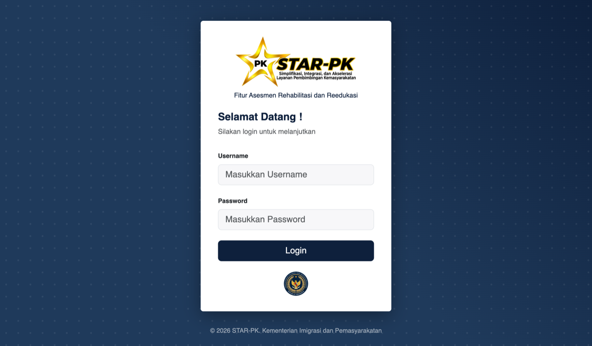
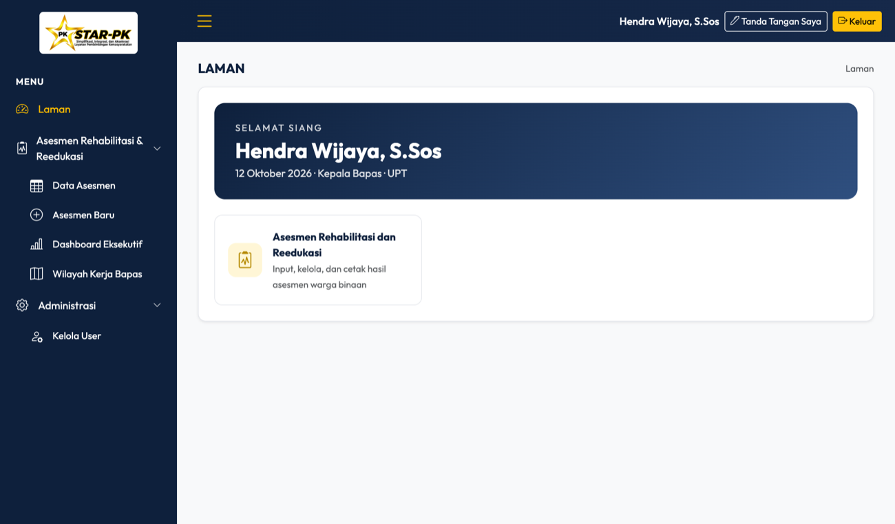
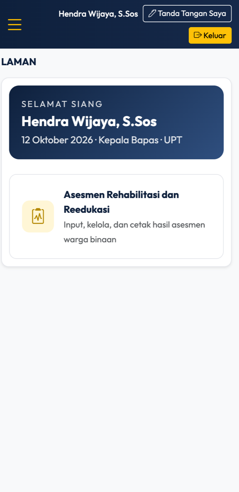
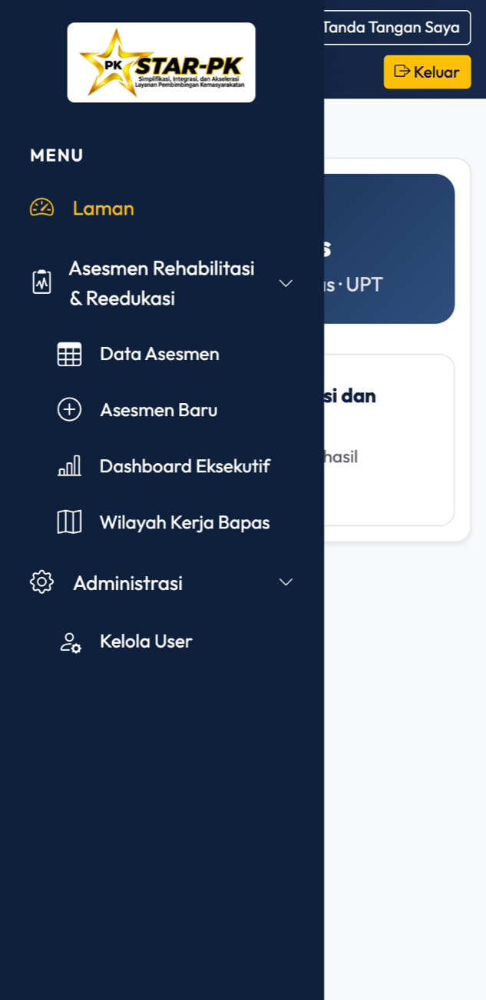
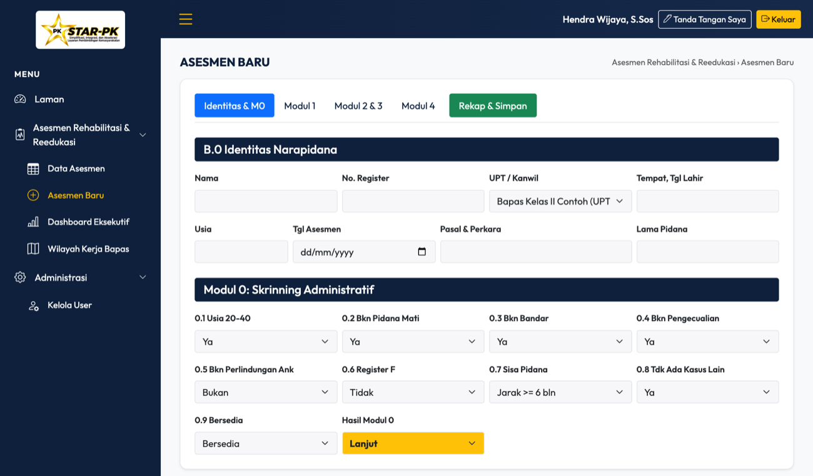
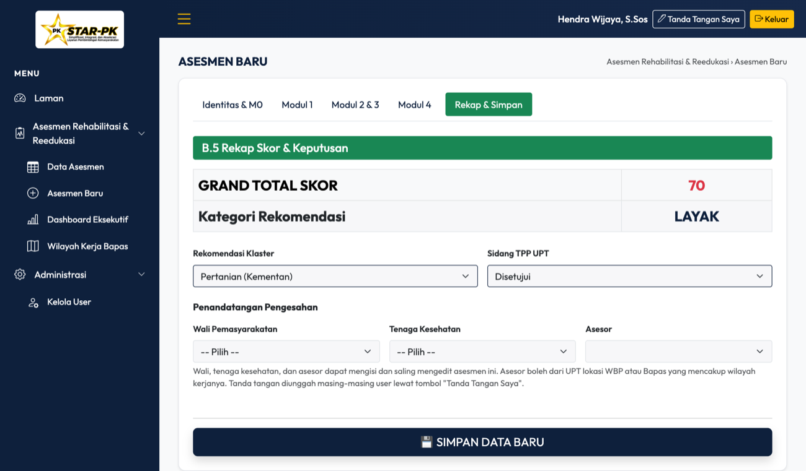
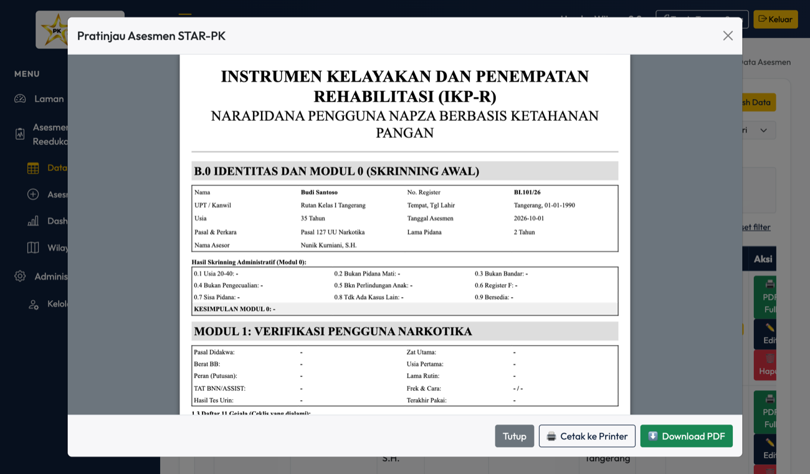
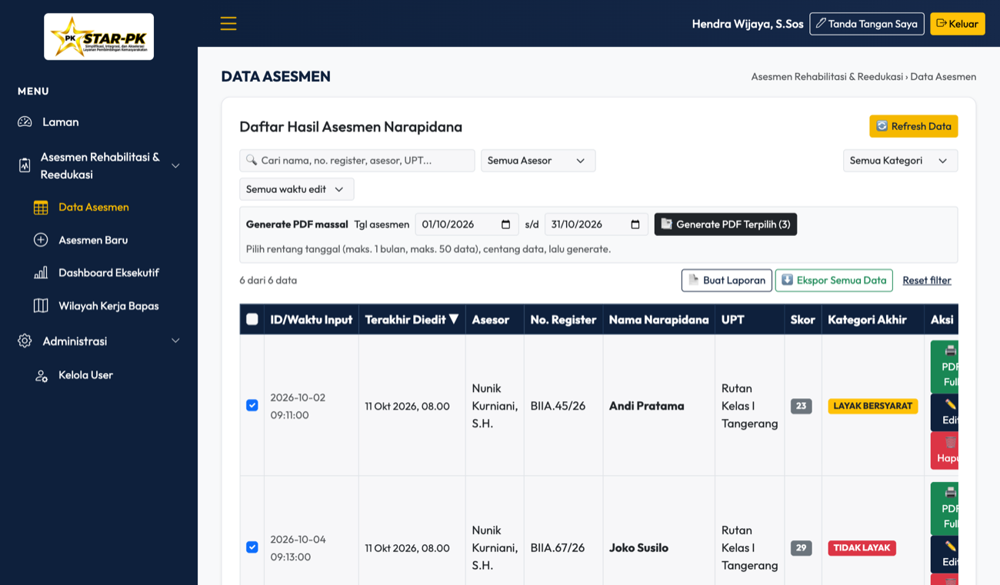
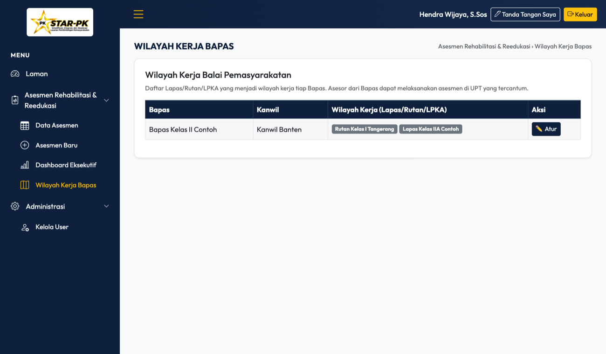

# Pedoman Penggunaan STAR-PK
**Fitur Asesmen Rehabilitasi dan Reedukasi** — Kementerian Imigrasi dan Pemasyarakatan

## 1. Gambaran Umum
STAR-PK adalah aplikasi web untuk mengisi, mengelola, dan mencetak hasil asesmen kelayakan dan penempatan rehabilitasi (instrumen IKP-R) bagi warga binaan. Aplikasi dibuka lewat peramban (Chrome, Edge, Firefox, Safari) di komputer maupun ponsel.

Ke depan STAR-PK akan memiliki enam modul: Registrasi Warga Binaan, Penelitian Kemasyarakatan (Litmas), Pendampingan, Pembimbingan, Pengawasan, dan Sidang TPP. Saat ini yang aktif adalah Asesmen Rehabilitasi dan Reedukasi, yang nantinya berada di bawah modul Litmas.

## 2. Peran Pengguna
| Tingkat | Hak utama |
|---|---|
| **UPT** (Bapas/Lapas/Rutan/LPKA) | Mengisi dan mengedit asesmen, melihat data UPT sendiri. Kepala Bapas mendapat fitur tambahan. |
| **Kanwil** | Memantau data seluruh UPT di wilayahnya. Tidak menginput asesmen baru. |
| **Ditjen** | Memantau seluruh data nasional, filter per Kanwil, dan mengelola master data. |

Satu pengguna dapat memiliki lebih dari satu **status penandatangan**: **Asesor**, **Wali**, **Tenaga Kesehatan**.

- Wali dan tenaga kesehatan bekerja di UPT tempat warga binaan berada.
- Asesor dapat berasal dari UPT tempat warga binaan berada atau dari Bapas yang wilayah kerjanya mencakup UPT tersebut.
- Wali, tenaga kesehatan, dan asesor dapat saling mengisi dan mengedit asesmen yang sama.
- Wali dan tenaga kesehatan dapat mengedit seluruh asesmen warga binaan di UPT tempat mereka bekerja.

## 3. Masuk dan Keluar

*Gambar: Halaman login*
1. Buka alamat aplikasi (`https://star-pk.id`).
2. Isi **Username** dan **Password**, lalu klik **Login**. Username dan password awal biasanya NIP; segera hubungi admin bila lupa.
3. Untuk keluar, klik **Keluar** di pojok kanan atas.

Sesi login berlaku sekitar 12 jam. Setelah itu login ulang.

## 4. Mengenal Tampilan

*Gambar: Halaman Laman dan sidebar*

*Gambar: Tampilan di ponsel*

*Gambar: Menu di ponsel (tombol ☰)*
- **Sidebar (kiri)**: menu. Di ponsel, buka dengan tombol ☰ di bar atas.
- **Bar atas**: nama pengguna dan **Keluar**.
- **Laman**: halaman awal dengan sapaan dan pintasan ke fitur asesmen.
- Menu yang tampil mengikuti hak akses Anda.

## 5. Profil Saya (Password dan Tanda Tangan)

Buka menu **Profil Saya** di sidebar. Halaman ini berisi dua bagian:

- **Ubah Password**: isi password lama, password baru (minimal 6 karakter), lalu ulangi password baru dan klik **Simpan Password**. Disarankan segera mengganti password awal.
- **Tanda Tangan Saya**: unggah gambar tanda tangan (PNG/JPG), lalu klik **Simpan Tanda Tangan**. Tanda tangan ini otomatis muncul di bagian pengesahan PDF hasil asesmen.

## 6. Membuat Asesmen Baru

*Gambar: Formulir identitas dan Modul 0*

*Gambar: Rekap skor dan pemilihan penandatangan*
Menu: **Asesmen Rehabilitasi & Reedukasi → Asesmen Baru** (khusus tingkat UPT).

1. **B.0 Identitas Narapidana**: isi nama, nomor register, dan data lainnya. Pilih **UPT/Kanwil** dari dropdown (UPT sendiri atau UPT dalam wilayah kerja Bapas Anda).
2. **Modul 0**: Skrinning Administratif.
3. **Modul 1**: Data dokumen, wawancara, daftar 11 gejala, dan kesimpulan.
4. **Modul 2**: Fisik dan medis.
5. **Modul 3**: Risiko dan stabilitas.
6. **Modul 4**: Minat dan bakat (4A), motivasi dan kesiapan berubah (4B), sikap dan fisik (4C/4D).
7. **Rekap**: periksa skor total dan kategori, lalu pilih **Asesor, Wali, dan Tenaga Kesehatan** penandatangan.
8. Klik **Simpan**.

Catatan: UPT/Kanwil tidak dapat diubah setelah data disimpan.

## 7. Melihat, Mencari, dan Mengedit Data

*Gambar: Daftar data asesmen*
Menu: **Data Asesmen**.

- **Cari** berdasarkan nama, nomor register, atau asesor.
- **Filter**: asesor, Kanwil (khusus Ditjen), UPT, kategori, dan status edit. Klik **Reset filter** untuk mengosongkan.
- **Urutkan** dengan klik judul kolom.
- Badge **baru** menandai data yang baru diinput atau diedit.
- Tombol **Edit** muncul hanya bila Anda berhak mengedit data tersebut.

## 8. Cetak dan Pratinjau PDF

*Gambar: Pratinjau PDF hasil asesmen*
Pada baris data, klik tombol cetak/pratinjau untuk melihat hasil asesmen. Dari jendela pratinjau Anda dapat mencetak atau mengunduh PDF.

Bagian pengesahan menampilkan tanda tangan: **Wali di kiri, Tenaga Kesehatan di tengah, Asesor di kanan**.

## 9. Fitur Kepala Bapas

*Gambar: Generate PDF massal*

*Gambar: Wilayah Kerja Bapas*
Hanya tampil bagi Kepala Bapas.

**Generate PDF massal (1 data = 1 file PDF)**
1. Pilih **Tanggal awal** dan **Tanggal akhir** asesmen. Rentang maksimal **1 bulan**.
2. Centang data yang diinginkan (maksimal 50 data per proses).
3. Klik **Generate PDF Terpilih**, tunggu pratinjau muncul, lalu unduh. Setiap data menjadi satu file bernama `Asesmen_IKPR_<noreg>_<nama>.pdf`.

**Wilayah Kerja Bapas**: kelola daftar Lapas/Rutan/LPKA yang menjadi wilayah kerja Bapas, agar asesor Bapas dapat menilai warga binaan di UPT tersebut.

**Kunci aplikasi**: tombol untuk mengunci/membuka penginputan dan perubahan data. Saat terkunci, banner merah tampil dan data tidak dapat diubah.

## 10. Dashboard Eksekutif, Laporan, dan Ekspor
- **Dashboard Eksekutif**: ringkasan statistik asesmen (untuk pimpinan, Kanwil, dan Ditjen).
- **Buat Laporan**: membuat laporan hasil asesmen sebagai PDF.
- **Ekspor CSV**: mengunduh data dalam format CSV (khusus pimpinan).

## 11. Menu Administrasi (Kanwil dan Ditjen)
| Menu | Fungsi |
|---|---|
| Kelola Wilayah | Master Kanwil (Ditjen) |
| Kelola UPT | Master UPT Lapas/Rutan/LPKA/Bapas |
| Kelola User | Tambah/ubah/nonaktifkan pengguna, atur peran dan status penandatangan (bisa lebih dari satu) |
| Profil Ditjen | Nama instansi, Dirjen, alamat |

Kepala Bapas dapat mengelola pengguna di UPT-nya.

## 12. Pertanyaan Umum
| Masalah | Solusi |
|---|---|
| Tidak bisa login | Periksa username/password. Bila tetap gagal, hubungi admin untuk reset. |
| Tombol Edit tidak muncul | Anda bukan pemilik/penandatangan data itu, UPT berbeda, atau aplikasi sedang dikunci. |
| Menu Asesmen Baru tidak ada | Akun Kanwil dan Ditjen hanya memantau, atau aplikasi sedang terkunci. |
| Pilihan UPT tidak lengkap | Minta Kepala Bapas melengkapi Wilayah Kerja Bapas. |
| Tampilan tidak berubah setelah pembaruan | Muat ulang paksa dengan Ctrl+Shift+R. |
| Sesi tiba-tiba keluar | Sesi habis (±12 jam), login ulang. |

## 13. Tips
- Simpan data secara berkala dan periksa nomor register sebelum menyimpan.
- Jaga kerahasiaan password dan jangan bagikan akun.
- Selalu klik **Keluar** bila memakai perangkat bersama.

---
*Seluruh tangkapan layar memakai data contoh fiktif.*
